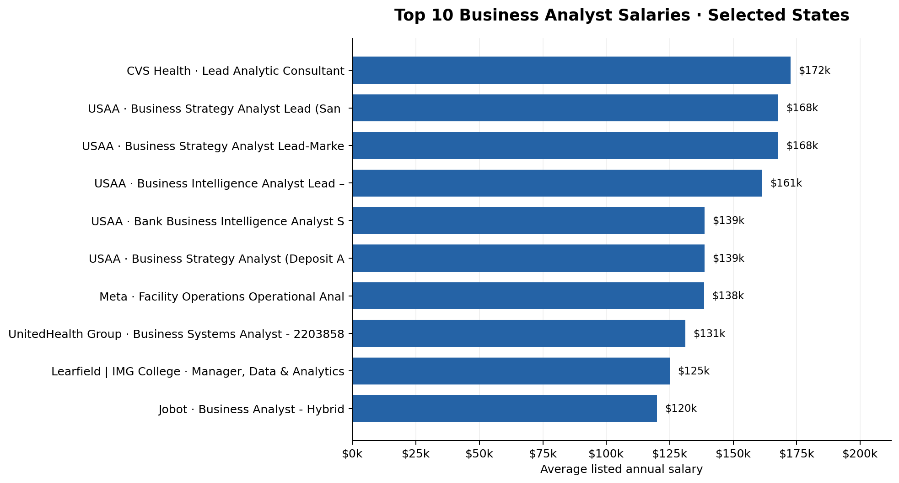
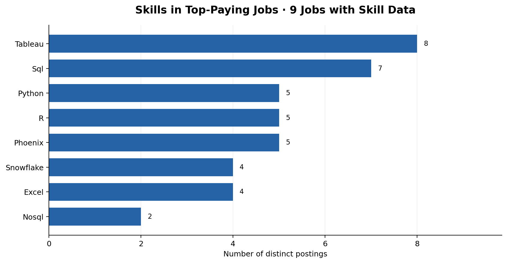
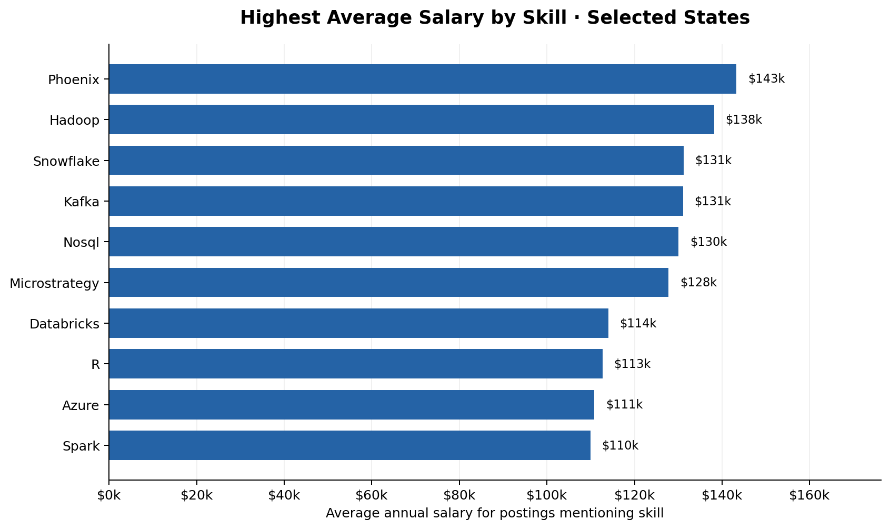
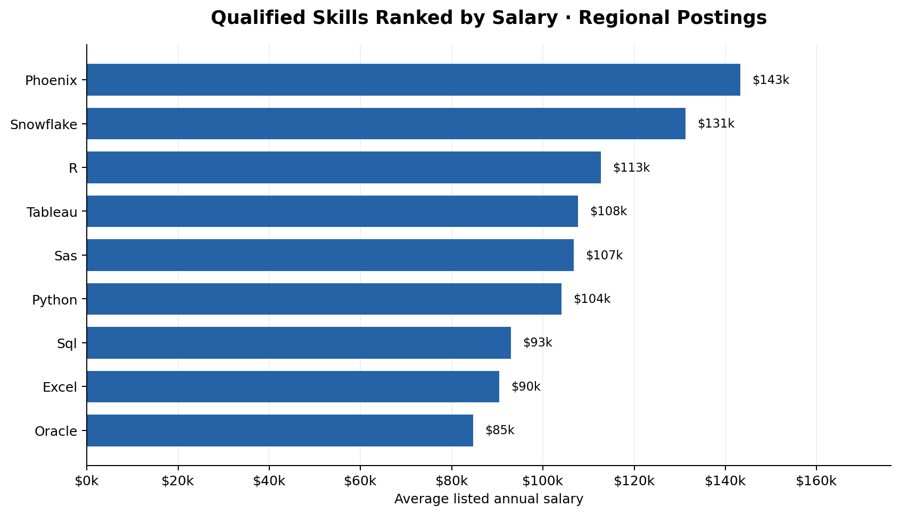
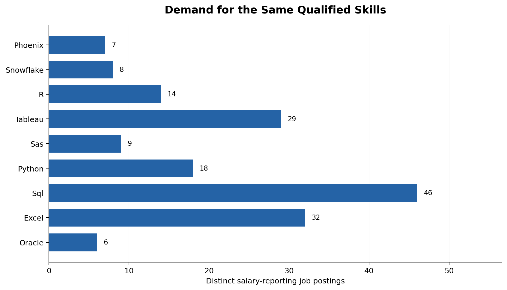

# SQL Project: Business Analyst Job Market Analysis

## Introduction

This project explores the **2023 Business Analyst job market** using SQL to examine high-paying positions, employer skill requirements, the most frequently requested skills, and the relationship between skills and salary. To explore opportunities in my region, I focused several queries on job postings in **Arkansas, Oklahoma, Texas, Tennessee, and Mississippi**.

The goal was to use actual job-posting data to identify practical skills to prioritize for a career in business analytics.

**SQL scripts:** [View the project queries](#how-you-used-the-tools)  
**Query outputs:** The associated CSV files contain the results discussed below.

## Background

The dataset comes from an SQL course and includes job titles, locations, salaries, companies, and listed skills. I used it to explore the following questions:

1. What are the top-paying Business Analyst jobs in my selected states?
2. What skills are required for those top-paying jobs?
3. What skills are most in demand for Business Analysts across all job postings?
4. Which skills are associated with the highest average salaries in my selected states?
5. Which skills combine a meaningful level of local demand with relatively high salaries?

**Scope:** The regional queries filter job locations ending in `AR`, `OK`, `TX`, `TN`, or `MS`, and exclude postings without an annual salary. The demand-only query uses **all locations** and does **not** require salary data. The job dataset reflects 2023 postings, not current job availability. A state-based location filter is not the same as a distance or commute-radius filter.

## Tools Used

- **SQL:** Filtered, joined, grouped, and ranked job postings and associated skills.
- **PostgreSQL:** Queried the relational job-posting dataset.
- **Visual Studio Code:** Worked with SQL scripts and project files.
- **Git and GitHub:** Organized SQL scripts and documented the analysis in a reproducible project format.

## How You Used the Tools

I used five PostgreSQL queries to answer the project's research questions. Each section explains the SQL approach, shows the original query, and displays results from the corresponding CSV export. The SQL and CSV links let readers inspect the full work.

### 1. Top-Paying Business Analyst Jobs
**Question:** Which 10 Business Analyst job postings in my five selected states reported the highest annual salaries?

The query filters for the Business Analyst job category, the five states, and non-null annual salaries, then sorts salaries from highest to lowest.

**SQL file:** [`1_top_paying_jobs(1).sql`](1_top_paying_jobs%281%29.sql)  
**CSV output:** [`1. top paying jobs - Copy.csv`](1.%20top%20paying%20jobs%20-%20Copy.csv)

```sql
/* 
Question: What are the top-paying business analyst jobs?**
- Identify the top 10 highest-paying Business Analyst roles that are available locally for my location.
- Focuses on job postings with specified salaries. (remove nulls)
- Why? Aims to highlight the top-paying opportunities for Business Analysts, offering insights into employment options and location flexibility.
*/

SELECT
	job_id,
	job_title,
	job_location,
	job_schedule_type,
	salary_year_avg,
	job_posted_date,
    name AS company_name
FROM
    job_postings_fact
LEFT JOIN company_dim
    ON job_postings_fact.company_id = company_dim.company_id
WHERE
    job_title_short = 'Business Analyst'
    AND job_location ILIKE ANY (
        ARRAY['%, AR', '%, OK', '%, TX', '%, TN', '%, MS'])
    AND salary_year_avg IS NOT NULL
ORDER BY
    salary_year_avg DESC
LIMIT 10;

/*
Analysis: Top-Paying Business Analyst Jobs
- All of the top paying jobs in my region are in Texas.
- The salary range for the top paying jobs ranges from $120,000 to $172,500. With the average being $146,121.
- USAA appears to be a well paying employer, contributing 5 of the 10 highest paying jobs
- Unsurpisingly, the top paying jobs are all senior/lead-level positions, with 5 of the 10 being senior-level roles.
*/
```

| Company | Role | Location | Annual salary |
| --- | --- | --- | --- |
| CVS Health | Lead Analytic Consultant | Irving, TX | $172,500 |
| USAA | Business Strategy Analyst Lead (San Antonio, TX) | San Antonio, TX | $167,755 |
| USAA | Business Strategy Analyst Lead-Marketing & Offer Strategy (San... | San Antonio, TX | $167,755 |
| USAA | Business Intelligence Analyst Lead – Property & Casualty Insurance... | San Antonio, TX | $161,335 |
| USAA | Bank Business Intelligence Analyst Senior | San Antonio, TX | $138,640 |
| USAA | Business Strategy Analyst (Deposit Analytics) (San Antonio, TX) | San Antonio, TX | $138,640 |
| Meta | Facility Operations Operational Analyst | Austin, TX | $138,500 |
| UnitedHealth Group | Business Systems Analyst - 2203858 | San Antonio, TX | $131,085 |
| Learfield \| IMG College | Manager, Data & Analytics | Plano, TX | $125,000 |
| Jobot | Business Analyst - Hybrid | China Spring, TX | $120,000 |

**Visualization**



*Annual salaries for the ten highest-paying jobs in the selected states.*

### 2. Skills Required for Top-Paying Jobs
**Question:** What skills are listed for the highest-paying Business Analyst roles from Query 1?

A common table expression (CTE) identifies the top-paying postings. Joining those postings to the skill tables reveals the technologies mentioned in each job listing.

**SQL file:** [`2_top_paying_job_skills(1).sql`](2_top_paying_job_skills%281%29.sql)  
**CSV output:** [`2. top paying job skills - Copy.csv`](2.%20top%20paying%20job%20skills%20-%20Copy.csv)

```sql
/* 
Question: What are the top-paying business analyst jobs, and what skills are required?** 
- Identify the top 10 highest-paying Business Analyst jobs and the specific skills required for these roles.
- Filters for roles with specified salaries that are available locally for my location. (remove nulls)
- Why? It provides a detailed look at which high-paying jobs demand certain skills, helping job seekers like myself understand which skills to develop that align with top salaries
*/

WITH top_paying_jobs AS (
    SELECT
        job_id,
        job_title,
        job_location,
        salary_year_avg,
        name AS company_name
    FROM
        job_postings_fact
    LEFT JOIN company_dim
        ON job_postings_fact.company_id = company_dim.company_id
    WHERE
        job_title_short = 'Business Analyst'
        AND job_location ILIKE ANY (
            ARRAY['%, AR', '%, OK', '%, TX', '%, TN', '%, MS'])
        AND salary_year_avg IS NOT NULL
    ORDER BY
        salary_year_avg DESC
    LIMIT 10
)

SELECT 
    top_paying_jobs.*,
    skills
FROM top_paying_jobs
INNER JOIN skills_job_dim
    ON top_paying_jobs.job_id = skills_job_dim.job_id
INNER JOIN skills_dim
    ON skills_job_dim.skill_id = skills_dim.skill_id
ORDER BY
    top_paying_jobs.salary_year_avg DESC;

/* Analysis: Top-Paying Business Analyst Jobs and Required Skills with Them
- Data visualizations skills are clearly essential for Business Analysts,
  with Tableau appearing in 89% of the top-paying jobs
- SQL is heavily in demand as well, appearing in 78% of the top-paying jobs
- Python and R both appear in 56% of postings
- Excel may be old, but it still appears in 44% of postings, showing it's relevance still
*/
```

| Skill | Jobs mentioning skill | Share of jobs with skill data |
| --- | --- | --- |
| tableau | 8 | 88.9% |
| sql | 7 | 77.8% |
| phoenix | 5 | 55.6% |
| python | 5 | 55.6% |
| r | 5 | 55.6% |
| excel | 4 | 44.4% |
| snowflake | 4 | 44.4% |
| hadoop | 2 | 22.2% |

**Visualization**



*Distinct job-posting counts for the most commonly named skills.*

### 3. Most In-Demand Business Analyst Skills
**Question:** Which five skills appear most often in Business Analyst job listings across the dataset?

This query counts the number of Business Analyst job postings associated with each skill. Unlike the other queries, it does not restrict locations or require a reported salary.

**SQL file:** [`3_top_demanded_skills(1).sql`](3_top_demanded_skills%281%29.sql)  
**CSV output:** [`3. top demanded skills - Copy.csv`](3.%20top%20demanded%20skills%20-%20Copy.csv)

```sql
/*
Question: What are the most in-demand skills for business analysts?**
- Identify the top 5 in-demand skills for a business analyst.
- Focus on all job postings.
- Why? Retrieves the top 5 skills with the highest demand in the job market, 
  providing insights into the most valuable skills for job seekers.
*/

SELECT
    skills,
    COUNT(skills_job_dim.job_id) AS demand_count
FROM
  job_postings_fact
INNER JOIN
    skills_job_dim ON job_postings_fact.job_id = skills_job_dim.job_id
INNER JOIN
    skills_dim ON skills_job_dim.skill_id = skills_dim.skill_id
WHERE
    job_title_short = 'Business Analyst'
GROUP BY
    skills
ORDER BY
    demand_count DESC
LIMIT 5;

/* Analysis: Most In-Demand Skills for Business Analysts
- SQL is the most demanded skill for Business Analysts, showing up 17,372 times!
- Excel appeared nearly as much, with 17,134 postings. This is interesting because it 
  showed up in 44% of the top-paying jobs, showing that while it may not be a high-paying skill,
  it is still highly demanded in the job market and an essential entry level skill.
- Tableau and Power BI both appeared roughly 9,300 times, showing that data visualization 
  is a highly demanded skill for Business Analysts.
- Python leans more into data science, but it still came in as the 5th most demanded skill
  for Business Analysts, appearing 8,097 times. It's a skill that takes time to learn but is
  essential for the high paying jobs
*/
```

| Skill | Job postings |
| --- | --- |
| SQL | 17,372 |
| Excel | 17,134 |
| Tableau | 9,324 |
| Power Bi | 9,251 |
| Python | 8,097 |

**Visualization**


*Skill demand in Business Analyst job postings across all locations.*

### 4. Highest-Paying Skills
**Question:** Which skills are associated with the highest average reported annual salaries in the five selected states?

The query groups Business Analyst job postings by associated skill and calculates the average listed annual salary. It then ranks skills in descending order by average salary.

**SQL file:** [`4_top_paying_skills(1).sql`](4_top_paying_skills%281%29.sql)  
**CSV output:** [`4. top paying skills - Copy.csv`](4.%20top%20paying%20skills%20-%20Copy.csv)

```sql
/*Answer: What are the top skills based on salary?** 
- Look at the average salary associated with each skill for Business Analyst positions.
- Focuses on roles with specified salaries, with a focus on local job postings. (remove nulls)
- Why? It reveals how different skills impact salary levels for Business Analysts and helps identify the most financially rewarding skills to acquire or improve.
*/

SELECT
    skills,
    ROUND(AVG(salary_year_avg), 2) AS avg_salary
FROM
  job_postings_fact
INNER JOIN
    skills_job_dim ON job_postings_fact.job_id = skills_job_dim.job_id
INNER JOIN
    skills_dim ON skills_job_dim.skill_id = skills_dim.skill_id
WHERE
    job_title_short = 'Business Analyst' AND
    salary_year_avg IS NOT NULL AND    
    job_location ILIKE ANY (
            ARRAY['%, AR', '%, OK', '%, TX', '%, TN', '%, MS'])
GROUP BY
    skills
ORDER BY
    avg_salary DESC
LIMIT 25;

/* Analysis: Top Skills Based on Salary for Business Analysts
- This query returned a much more niche set of skills that I'm not super familiar with
- The results lead me to want to explore the quantity of postings associated with each of these
  niche skills
- Python has an average salary of $104,038. Supporting the claim that it is a high-paying skill,
  but it is not as in-demand as other skills like SQL and Excel
- Excel doesn't appear here, but SQL does with an average salary of $92,964
*/
```

| Skill | Average annual salary |
| --- | --- |
| Phoenix | $143,303.57 |
| Hadoop | $138,158.33 |
| Snowflake | $131,222.50 |
| Kafka | $131,085 |
| Nosql | $130,068.75 |
| Microstrategy | $127,766.67 |
| Databricks | $114,000 |
| R | $112,692.79 |
| Azure | $110,833.33 |
| Spark | $109,900 |

**Visualization**



*Average salary of the ten highest-paid skills from the regional dataset.*

### 5. Most Optimal Skills to Learn
**Question:** Which skills have both recurring demand and relatively high average reported salaries in the five selected states?

This query combines the count of **distinct jobs** requesting a skill with its average annual salary. To reduce reliance on skills mentioned in very few listings, it keeps only skills present in **more than five** salary-reporting postings.

**SQL file:** [`5_optimal_skills(1).sql`](5_optimal_skills%281%29.sql)  
**CSV output:** [`5. optimal skills(1).csv`](5.%20optimal%20skills%281%29.csv)

```sql
/*
Answer: What are the most optimal skills to learn (aka it’s in high demand and a high-paying skill) for a business analyst?** 
- Identify skills in high demand and associated with high average salaries for Business Analyst roles
- Concentrates on local positions with specified salaries
- Why? Targets skills that offer job security (high demand) and financial benefits (high salaries),
  offering strategic insights for career development in data analysis
*/

SELECT
    skills_dim.skill_id,
    skills_dim.skills,
    COUNT(DISTINCT job_postings_fact.job_id) AS demand_count,
    ROUND(AVG(salary_year_avg), 2) AS avg_salary
FROM
    job_postings_fact
INNER JOIN skills_job_dim
    ON job_postings_fact.job_id = skills_job_dim.job_id
INNER JOIN skills_dim
    ON skills_job_dim.skill_id = skills_dim.skill_id
WHERE
    job_title_short = 'Business Analyst'
    AND salary_year_avg IS NOT NULL
    AND job_location ILIKE ANY (
        ARRAY['%, AR', '%, OK', '%, TX', '%, TN', '%, MS']
    )
GROUP BY
    skills_dim.skill_id
HAVING
    COUNT(DISTINCT job_postings_fact.job_id) > 5
ORDER BY
    avg_salary DESC,
    demand_count DESC
LIMIT 25;

/* Analysis: Optimal Skills for Business Analysts
- Tableau appears to be the most optimal skill to learn for Business Analysts,
  appearing 29 times and having the 4th highest average salary among qualified skills
  with an average salary of $107,688.
- Phoenix is the highest paying optimal skill, being demanded 7 times in my region with
  an average salary of $143,303.
*/
```

| Skill | Job postings | Average annual salary |
| --- | --- | --- |
| Phoenix | 7 | $143,303.57 |
| Snowflake | 8 | $131,222.50 |
| R | 14 | $112,692.79 |
| Tableau | 29 | $107,688.45 |
| Sas | 9 | $106,709.33 |
| Sas | 9 | $106,709.33 |
| Python | 18 | $104,038.03 |
| SQL | 46 | $92,964.77 |
| Excel | 32 | $90,395.31 |
| Oracle | 6 | $84,750 |
| Power Bi | 17 | $83,952.94 |
| Powerpoint | 14 | $76,517.86 |
| Word | 9 | $71,833.33 |

**Visualization**



*Average salaries for qualified skills, after excluding one duplicate SAS label from this visualization.*



*The second chart shows job-posting counts for the same skills; comparing these charts helps distinguish high salary from broader demand.*

## What You Learned

This project helped me practice important SQL and analytical techniques:

- **Filtering and sorting:** Used `WHERE`, `ILIKE ANY`, `IS NOT NULL`, `ORDER BY`, and `LIMIT` to focus on relevant opportunities.
- **Combining tables:** Used `LEFT JOIN` and `INNER JOIN` to connect postings, companies, and skills, while recognizing how join type affects the result set.
- **Common table expressions:** Used a `WITH` clause to isolate top-paying jobs before analyzing their associated skills.
- **Aggregating data:** Used `COUNT`, `COUNT(DISTINCT ...)`, `AVG`, `ROUND`, `GROUP BY`, and `HAVING` to measure demand and salary patterns.
- **Interpreting results:** Compared salary with frequency of skill mentions, checked denominators, and distinguished patterns in a sample from broader claims about the labor market.

## Insights

These are my conclusions from the 2023 job-posting dataset. I used the original CSV exports to check the figures and treated demand and salary as separate measures rather than assuming that a skill necessarily causes higher pay.

### 1. Top-Paying Business Analyst Jobs

- **All ten of the highest-paying postings in my selected region were in Texas.** Even though my query searched Arkansas, Oklahoma, Texas, Tennessee, and Mississippi, none of the other states appeared in the top ten.
- **Salaries ranged from $120,000 to $172,500, averaging $146,121.** This gives me a sense of the compensation potential for experienced analysts in the region.
- **USAA accounted for 5 of the 10 postings**, making it a company worth considering when exploring higher-paying analyst careers.
- Most of these positions involved lead, senior, or specialized responsibilities. **Five titles explicitly indicated senior or lead-level roles**, suggesting experience may be important for reaching the upper end of this salary range.

### 2. Skills for Top-Paying Jobs

- **Tableau stood out at 8 of 9 jobs (89%) with matching skill data**, reinforcing the importance of data visualization for Business Analysts.
- **SQL appeared in 7 of 9 jobs (78%)**, making it another clear priority for skill development.
- **Python and R each appeared in 5 of 9 jobs (56%)**, showing that programming and statistical tools are relevant even for Business Analyst titles.
- **Excel appeared in 4 of 9 (44%)**. Although it is an established tool, employers still request it for highly paid analytical positions.

*Method note: The first query returns ten jobs, but the skills query has matching records for nine unique jobs. Percentages refer to these nine jobs, not all ten.*

### 3. Most In-Demand Business Analyst Skills

- **SQL led with 17,372 postings**, followed closely by **Excel with 17,134**. These appear to be foundational skills worth mastering.
- **Tableau (9,324) and Power BI (9,251)** had nearly identical counts, strengthening the case for learning at least one major visualization platform.
- **Python ranked fifth with 8,097 postings**. It takes more time to develop, but its appearance in both the broad demand results and the high-paying job sample makes it an attractive longer-term investment.

*This query covered all locations and did not require salary data, so its counts should not be compared directly with the smaller regional salary-reporting sample.*

### 4. Skills Associated with Higher Salaries

- The highest-paid skills list introduced me to **specialized technologies I was not very familiar with**, including Phoenix, Hadoop, Snowflake, Kafka, and NoSQL.
- It also raised a follow-up question: **How many job postings actually request each niche skill?** A high average based on very few roles may not make a skill a broadly useful priority.
- **Python averaged $104,038** in the regional salary data, supporting its value beyond its demand ranking.
- **SQL also made the top 25 at $92,964.77**, while **Excel did not appear in that top-25 list**. That suggests that demand alone does not determine where a skill ranks on average salary.

### 5. Most Optimal Skills to Learn

- **Tableau stands out to me as the best overall balance**: it appeared in **29 qualifying regional postings** and had the **fourth-highest average salary among the distinct skill names in the qualifying results, at $107,688.45**.
- **Phoenix had the highest average salary, $143,303.57**, but appeared in only **7 postings** in the regional salary-reporting sample. I would investigate its niche applications before treating it as a top learning priority.
- **Snowflake averaged $131,222.50 across 8 postings**. It may be worth exploring after building a stronger foundation in broadly requested tools.
- SQL (**46 postings**), Excel (**32**), Python (**18**), and Power BI (**17**) offer additional context when deciding how to balance job-market demand with potential compensation.

## Conclusion

This project helped me turn career questions into SQL analyses and compare the skills employers request with the salaries listed in job postings. **SQL and Excel** were the most frequently requested skills across the full dataset, while **Tableau and SQL** appeared especially often in the highest-paying regional jobs with available skill records.

My biggest takeaway is that **Data visualizations tools, such as Tableau and Power BI, offers a compelling balance of demand and salary** in the regional results. Python is another important skill for me to continue learning, and specialized tools such as Snowflake are worth exploring once I have stronger foundations. I also learned why a high salary average is only part of the story: **the number of jobs, geography, seniority, and the availability of salary data all matter** when evaluating which skills to prioritize.

The project strengthened my SQL querying, data aggregation, and analytical interpretation skills. More importantly, it gave me a repeatable approach for using evidence not just assumptions to guide my next steps in business analytics.

This course was my first introduction to SQL so it has given me a very strong foundation to build upon and continue exploring more databases using SQL. I'm extremely glad
I took the time to do this, as the data in this database proved, SQL is a foundational and crucial skill to having a career as a Business Analyst.
---

*Source: SQL-course dataset of 2023 job postings. These results describe historical postings rather than current job openings or salary guarantees.*
